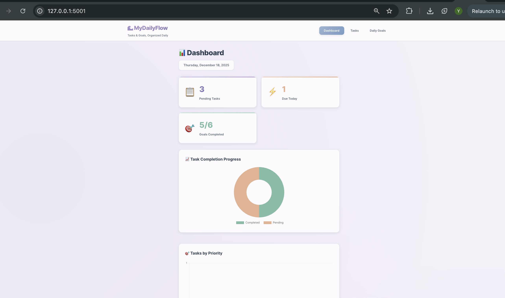

# MyDailyFlow

A student productivity web app for tracking assignments and daily habits, built with Flask and SQLAlchemy.



## Features
- **Dashboard:** pending tasks, tasks due today, habits completed, and charts for task progress and priority
- **Tasks:** add, edit, delete and mark assignments complete, with subject, due date and priority
- **Daily goals:** track habits by category with current and longest streaks

## Tech stack
Python, Flask, Flask-SQLAlchemy, SQLite, HTML/CSS (Jinja templates)

## Run locally
```bash
pip install -r requirements.txt
python app.py
```
Then open http://127.0.0.1:5001. The database is created on first run.

## Design document
[API Services and GDPR Compliance](docs/MyDailyFlow_API_Services_and_GDPR_Compliance.pdf): how MyDailyFlow could offer APIs to personalisation providers, and what GDPR requires (lawful basis, data minimisation, data subject rights, processor agreements, security).

## Screenshots
See the [screenshots](screenshots/) folder.
